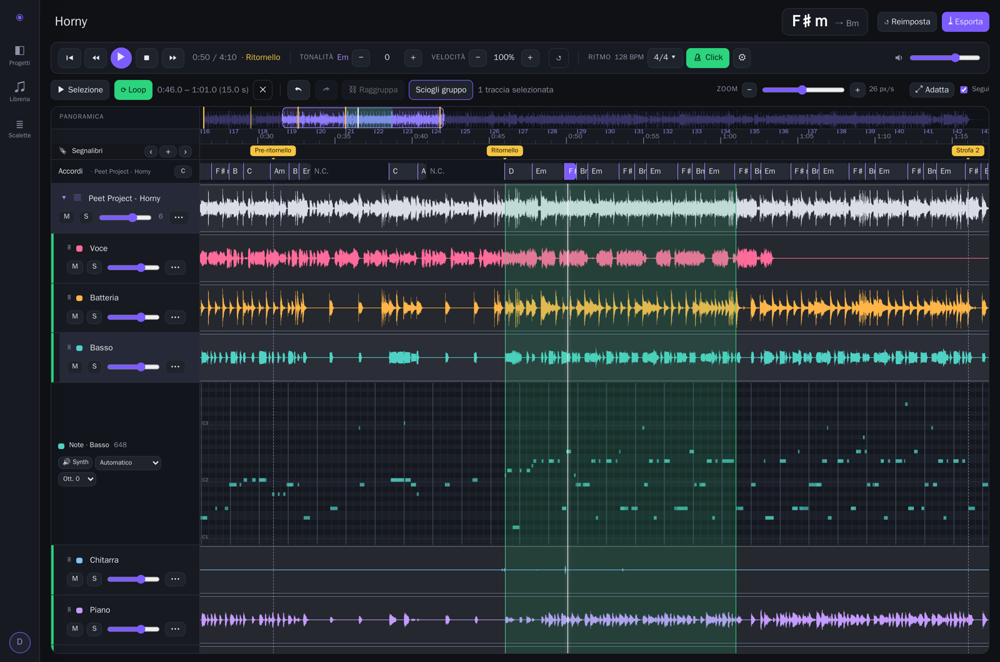
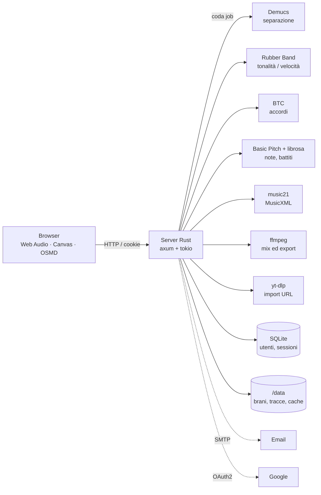

<div align="center">

# ◉ Noises

**Separa le tracce, studia e suona i tuoi brani.**

Web app self-hosted in stile Moises: separazione delle tracce con l'AI, mixer multitraccia,
cambio di tonalità e velocità indipendenti, accordi, trascrizione delle note, spartito, tablatura,
click intelligente ed esportazione di basi.


**[Sito del progetto →](https://teopost.github.io/noises/)**



</div>

---

## Indice

- [Funzionalità](#funzionalità)
- [Avvio rapido](#avvio-rapido)
- [Raspberry Pi e server in rete](#raspberry-pi-e-server-in-rete)
- [Guida all'uso](#guida-alluso)
- [Autenticazione](#autenticazione)
- [Configurazione](#configurazione)
- [Architettura](#architettura)
- [API](#api)
- [Comandi make](#comandi-make)
- [Limiti noti](#limiti-noti)
- [Crediti e licenze di terze parti](#crediti-e-licenze-di-terze-parti)
- [Licenza](#licenza)

## Funzionalità

### Libreria e progetti
- **Libreria** dei brani (caricati dal computer o importati da **YouTube** e dagli altri siti supportati da yt-dlp, con avanzamento del download), con **playlist** e ricerca.
- **Progetti**: timeline multitraccia salvate, separate dalla libreria. Trascini i brani nella timeline e li tieni interi o ne separi le tracce.
- **Backup e ripristino** di un progetto così com'è: uno zip con un manifest, il progetto (tracce, clip, gruppi, segnalibri, sezioni, salvataggi) e tutti i suoi brani (audio originale, tracce separate, accordi, note e correzioni manuali). Ripristinato su un'altra installazione, i brani entrano nella libreria e il progetto si apre pronto.
- **Scalette**: elenchi ordinati di progetti da suonare in sequenza, con pausa configurabile tra un brano e l'altro (o attesa del Play), avanzamento automatico e barra con posizione e brano successivo.
- **Impostazioni salvate automaticamente** per progetto (tonalità, velocità, volumi, muto/solo, selezione, loop), con **Reimposta** per tornare all'originale, e **salvataggi** con un nome da richiamare e condividere.

### Separazione e mixer
- **Separazione delle tracce** con [Demucs v4](https://github.com/facebookresearch/demucs): 4 tracce (voce, batteria, basso, altro), 4 tracce in alta qualità, oppure 6 tracce (+ chitarra e piano). Si avvia dal menu ⋯ della traccia, quando vuoi tu.
- **Voce di massima qualità** con [Mel-Band RoFormer](https://huggingface.co/KimberleyJSN/melbandroformer) (4 o 6 tracce): la voce la separa RoFormer, più pulita di Demucs, e Demucs divide il resto. Sulla CPU è molto più lento (circa 8–10 minuti per minuto di brano su un portatile); il modello (900 MB) si scarica al primo uso in `/data/models`. Con una GPU (`DEMUCS_DEVICE=cuda`) la usa anche RoFormer.
- **Mixer** con muto, solo e volume per traccia e per gruppo, volume master.
- **Tonalità** (±12 semitoni) e **velocità** (50–150%) indipendenti, applicate **in tempo reale** nel browser; nei file esportati con [Rubber Band](https://breakfastquay.com/rubberband/). La tonalità del brano, già trasposta, compare accanto ai comandi.

### Editor multitraccia
- **Clip** spostabili, tagliabili (`X`) ed eliminabili; tracce aggiungibili da libreria, computer o YouTube, duplicabili, rinominabili, riordinabili.
- **Gruppi**: le tracce separate di un brano stanno in un gruppo apribile e chiudibile; con **Raggruppa** ne crei altri. Le tracce di un gruppo si spostano e si modificano insieme.
- **Annulla/ripeti** (`Ctrl+Z` / `Ctrl+Y`), **segnalibri** con nome e navigazione, **selezione** e **loop** con precisione al campione.
- **Zoom** in pixel al secondo (slider, `Ctrl` + rotella o pinch) e **panoramica** del progetto con un riquadro da trascinare.

### Pratica e registrazione
- **Sezioni salvate**: dai un nome a una porzione del brano (per esempio "Assolo 1") e richiamala con un clic dal pulsante **Sezioni ▾**: viene selezionata con il loop già attivo e la testina all'inizio. Le sezioni sono salvate nel progetto e restano al loro posto a ogni velocità.
- **Loop al volo**: durante l'ascolto `I` fissa l'inizio (l'area verde cresce mentre il brano va avanti) e `O` la fine, con il loop già attivo; gli stessi comandi sono nella barra (**[ I**, **O ]**).
- **Regolazione fine del loop**: i bordi si trascinano con il mouse (con `Ctrl` si agganciano al click), oppure si spostano di 0,1 s (`Shift`: 0,01 s, tenendo premuto scorrono) o al **click precedente o successivo**, anche mentre suona.
- **Linee delle battute** nella timeline, che seguono il tempo del click (casella **Battute**).
- **Salvataggi**: fotografie con un nome dello stato del progetto (tonalità, velocità, volumi, muto/solo di tracce e cartelle, master, selezione e loop), per esempio *Assolo in loop* o *Solo voce*. Si richiamano dal pulsante **💾 ▾**; quello in uso raccoglie da solo le modifiche successive.
- **Link pubblici**: un salvataggio diventa una pagina da condividere sui social, senza accesso, che riproduce il mix con il suo loop, la sua tonalità e la sua velocità. L'anteprima sui social mostra titolo, salvataggio, loop e forma d'onda del mix. Nella stessa pagina si possono includere altri salvataggi tra cui scegliere; i link seguono le modifiche ai salvataggi e si disattivano quando vuoi.
- **Registrazione di una traccia** dal microfono o dalla scheda audio mentre il progetto suona: traccia vuota da **＋ Aggiungi traccia → ⏺ Registra**, scelta dell'ingresso e dei canali (1, 2 o stereo), **VU meter**, **forma d'onda dal vivo** e compensazione automatica della latenza. Le nuove riprese sulla stessa traccia sostituiscono solo il tratto rifatto.

### Analisi musicale
- **Accordi** con [BTC](https://github.com/jayg996/BTC-ISMIR19): 170 accordi (maj, min, 7, maj7, m7, 6, m6, sus2, sus4, dim, dim7, m7♭5, aug, m(maj7)), riconosciuti sulle tracce separate o anche sul **brano intero**. Corsia degli accordi, accordo corrente e successivo, notazione C D E / Do Re Mi, **correzione manuale** e **ricalcolo**.
- **Trascrizione delle note** di tutte le tracce con [Basic Pitch](https://github.com/spotify/basic-pitch) e un rilevatore dei colpi di batteria per bande di frequenza (cassa, rullante, hi-hat).
- **Piano roll modificabile** per ogni traccia: spostare, allungare, aggiungere ed eliminare note, agganciate alla griglia ritmica.
- **Synth** per ascoltare le note trascritte, con 8 suoni (piano, piano elettrico, organo, marimba…) e scelta dell'ottava.

### Spartito, ritmo e basi
- **Spartito** (MusicXML generato con music21, visualizzato con OpenSheetMusicDisplay): pianoforte su doppio pentagramma, batteria in notazione percussiva, alterazioni secondo la tonalità. Stampa, PDF ed export MusicXML.
- **Tablatura** per chitarra (anche Drop D e Drop C) e basso a 4 o 5 corde, con corde e tasti scelti per limitare gli spostamenti della mano e gli accordi sopra le battute.
- **Cursore** che segue la riproduzione nello spartito e nella tablatura.
- **Click** con tre modalità: **Adattivo** (segue ogni colpo della batteria registrata), **Tempo medio** (segue il tempo della canzone livellando le irregolarità), **Metronomo** (BPM fisso, regolabile). Sei suoni, volume, **spostamento fine a orecchio** (±5 ms per passo) e accento sul primo tempo.
- **Metro** selezionabile (2/4, 3/4, 4/4, 5/4, 6/8, 12/8), spostamento del primo tempo, correzione del battito ×2/÷2.
- **Pre-conteggio** di 1 o 2 battute, che porta sempre sul primo tempo della battuta.
- **Esportazione** in MP3, WAV, FLAC o MIDI delle sole tracce attive (per esempio la base senza voce), del progetto intero o della selezione, con **click e pre-conteggio** inclusi per creare basi.

### Account e lingua
- **Interfaccia in italiano e in inglese**: segue la lingua del browser (italiano se il browser è in italiano, altrimenti inglese). Anche le email di conferma e di reset arrivano in quella lingua.
- **Registrazione con verifica dell'email**, accesso, password dimenticata con reset via email, cambio password.
- **Accesso con Google** (OAuth 2.0 / OpenID Connect con PKCE).
- **Più utenti**: ognuno vede solo i propri brani, progetti, scalette e playlist.
- **Amministrazione** (menu dell'account → 🛡 *Amministrazione*, solo per gli amministratori; il primo utente registrato è amministratore):
  - **Utenti**: ruolo (amministratore o utente), stato, ultimo accesso e ultima attività, brani, progetti, link e spazio occupato; un utente si può **disattivare** (esce subito e non può più accedere, i suoi dati restano).
  - **Inviti** via email, validi 7 giorni, anche con la registrazione chiusa; senza SMTP il link si copia e si manda a mano.
  - **Accessi**: accessi riusciti e falliti, uscite, registrazioni, con indirizzo IP e browser.
  - **Attività**: cosa fanno gli utenti (brani caricati, progetti creati o modificati, esportazioni, backup, link pubblici…), filtrabile per utente. Il registro si conserva 180 giorni.
  - **Sistema**: versione, statistiche, configurazione e **avviso di aggiornamento** quando su GitHub esce una nuova versione (pallino sull'avatar e sulla voce del menu).

## Avvio rapido

Requisiti: Docker con Compose v2 e `make`. Servono circa 6 GB di disco per l'immagine, che contiene PyTorch e i modelli, così l'app funziona anche senza internet.

```sh
git clone https://github.com/teopost/noises.git
cd noises
cp .env.example .env      # facoltativo: SMTP, Google SSO, porta…
make up                   # build + avvio
make open                 # apre http://localhost:8080
```

Al primo accesso **registra un account**: il primo utente diventa amministratore. Se l'SMTP non è configurato, il link di conferma lo trovi nei log:

```sh
make logs   # cerca la riga "[email non inviata — SMTP assente] … → http://…/api/auth/verify?token=…"
```

> In alternativa, imposta `EMAIL_VERIFICATION=false` in `.env` per attivare gli account senza conferma.

## Raspberry Pi e server in rete

Noises gira anche su **Raspberry Pi 4 o 5** e su qualsiasi computer ARM a 64 bit.

**Requisiti**
- **Raspberry Pi OS a 64 bit** (o un'altra distribuzione `arm64`): PyTorch non esiste per i sistemi a 32 bit, e la build si ferma con un messaggio chiaro.
- **Almeno 4 GB di RAM** (8 GB consigliati per i modelli più pesanti) e circa 8 GB liberi su disco, meglio un SSD che la scheda SD.
- Docker con Compose v2, `make` e `git`:
  ```sh
  curl -fsSL https://get.docker.com | sh
  sudo usermod -aG docker $USER   # poi esci e rientra
  sudo apt install -y make git
  ```

**Installazione con l'immagine pronta** (consigliata: niente compilazione sul Raspberry). La [CI](#immagine-docker-ci) pubblica l'immagine per `amd64` e `arm64` su GitHub Container Registry:

```sh
git clone https://github.com/teopost/noises.git
cd noises
cp .env.example .env
# in .env:
#   NOISES_IMAGE=ghcr.io/teopost/noises:latest
#   PUBLIC_URL=https://noises.tuodominio.it      # l'indirizzo del tunnel (vedi sotto)
make pull                                        # scarica l'immagine e avvia
```

Per aggiornare basta ripetere `make pull`. In alternativa `make up` costruisce l'immagine sul Raspberry (la prima volta 20–40 minuti).

**Accesso da fuori con Cloudflare Tunnel.** Il browser attiva il motore audio (tonalità e velocità in tempo reale) solo in pagine sicure: **HTTPS** oppure `localhost`. Aperta con `http://raspberrypi.local:8080` da un altro computer, l'app segnala che l'audio non può funzionare. Un [Cloudflare Tunnel](https://developers.cloudflare.com/cloudflare-one/connections/connect-networks/) risolve il problema: fornisce l'HTTPS e rende l'app raggiungibile anche fuori casa, senza aprire porte sul router.

1. Installa `cloudflared` sul Raspberry e crea un tunnel dalla dashboard di Cloudflare (Zero Trust → Networks → Tunnels).
2. Aggiungi un *public hostname*, per esempio `noises.tuodominio.it`, con servizio `http://localhost:8080`.
3. Imposta in `.env` `PUBLIC_URL=https://noises.tuodominio.it` (serve per i link delle email, per il redirect di Google, per i cookie sicuri e per le anteprime dei link pubblici sui social), poi `make pull` o `make restart`.

Per l'accesso con Google, aggiungi `https://noises.tuodominio.it/api/auth/google/callback` ai redirect URI autorizzati.

**Limiti di Cloudflare da tenere presenti**
- **Caricamenti fino a 100 MB** per file con il piano gratuito: i file audio più grandi vanno compressi, oppure importati da YouTube.
- **Risposte entro 100 secondi**: sul Raspberry il riconoscimento accordi e la trascrizione delle note, avviati dall'editor, possono richiedere di più. La separazione delle tracce invece lavora in coda e non ha questo limite.

**Prestazioni.** La separazione su Raspberry Pi è lenta: conta svariati minuti per brano con il modello veloce, molto di più con "alta qualità" o 6 tracce. Ascolto, tonalità e velocità girano nel browser, quindi restano fluidi. `DEMUCS_THREADS=4` in `.env` usa tutti i core del Pi.

### Immagine Docker (CI)

Il workflow [`.github/workflows/docker.yml`](.github/workflows/docker.yml) costruisce l'immagine per `linux/amd64` e `linux/arm64` (ARM in emulazione, un job per architettura) e la pubblica su `ghcr.io/teopost/noises`:

| Evento | Tag |
|---|---|
| push su `main` | `latest`, `sha-<commit>` |
| tag `v1.2.3` | `1.2.3`, `1.2` |
| avvio manuale (Actions → Immagine Docker → Run workflow) | come sopra, per il ramo scelto |

Le modifiche che toccano solo la documentazione e il sito (`docs/`) non avviano la build. L'immagine è pubblica: si scarica senza login.

## Guida all'uso

1. Dalla barra a sinistra apri **Progetti** e crea un progetto con **＋ Nuovo**.
2. Aggiungi un brano con **＋ Aggiungi traccia** (libreria, computer o YouTube), oppure trascinalo dalla **Libreria** o dal computer nella timeline.
3. Per separare le tracce usa il menu **⋯** della traccia → **Separa traccia**, scegli il tipo di separazione e le analisi da eseguire (accordi; ritmo e note).
4. Per suonare più progetti di fila crea una **Scaletta** dalla barra a sinistra.

| Azione | Come |
|---|---|
| Play / pausa | `Spazio` o ▶ |
| Avanti / indietro 5 s | `→` / `←` |
| Selezionare una porzione | trascina sulla timeline o sul righello |
| Loop della selezione | `L` o ⟳ Loop |
| Creare un loop durante l'ascolto | `I` (o **[ I**) fissa l'inizio alla testina (l'area verde cresce mentre suona), `O` (o **O ]**) la fine e attiva il loop (a loop attivo spostano subito inizio e fine) |
| Salvataggi (es. *Assolo in loop*, *Solo voce*) | **💾 Salvataggi** → *Salva lo stato attuale*: tonalità, velocità, volumi, muto/solo, selezione e loop; un clic sul nome lo richiama e lo rende *in uso*: da lì le modifiche (loop, sezioni, volumi, velocità…) vengono salvate dentro quel salvataggio, e i suoi link pubblici si aggiornano. *Esci dal salvataggio* per lavorare senza toccarne nessuno |
| Backup di un progetto | **Progetti** → ⤓ accanto al progetto: scarica `Nome.noises.zip` |
| Ripristino (anche su un'altra installazione) | **Progetti** → ⤒ e scegli lo zip: i brani entrano nella libreria (quelli già presenti si riusano), il progetto si apre; se il nome esiste già diventa *Nome (2)* |
| Link pubblico da condividere | **🔗 Condividi** (o 🔗 accanto a un salvataggio): pagina senza accesso che riproduce il mix con il suo loop; nella finestra si possono includere altri salvataggi da scegliere nella pagina; *Disattiva link* per revocarlo |
| Salvare la selezione come sezione / richiamarla | **＋ Salva sezione** · **Sezioni ▾** |
| Regolare inizio e fine del loop | trascina i bordi della selezione (`Ctrl`: aggancio al click) · ‹ › (0,1 s, `Shift`: 0,01 s) · « » (click precedente/successivo) |
| Registrare una traccia | traccia vuota da **＋ Aggiungi traccia → ⏺ Registra**, poi `R` o ⏺ nel trasporto; pausa o stop per fermare |
| Annullare selezione / chiudere i menu | `Esc` |
| Tagliare le clip selezionate alla testina | `X` |
| Eliminare la clip selezionata | `Canc` |
| Annulla / ripeti | `Ctrl+Z` / `Ctrl+Y` |
| Raggruppare / sciogliere le tracce selezionate | `Ctrl+G` / `Ctrl+Shift+G` |
| Riordinare le tracce | trascina la maniglia ⠿, oppure `Alt+↑` / `Alt+↓` |
| Segnalibri | `M` per aggiungere, `,` e `.` per il precedente e il successivo (anche ‹ ＋ › nella corsia) |
| Linee delle battute nella timeline | casella **Battute** accanto a *Segui* (serve l'analisi del ritmo) |
| Zoom | `Ctrl` + rotella, pinch, slider, oppure i bordi del riquadro nella panoramica |
| Scorrere | trascina il riquadro della panoramica, `Shift` + rotella, trackpad |
| Separare, rinominare, duplicare, esportare, eliminare una traccia | menu **⋯** della traccia |
| Note e spartito di una traccia separata | menu **⋯** → Mostra note · Spartito e tablatura |
| Modificare le note | clic per selezionare · trascina per spostare · bordo destro per la durata · doppio clic per aggiungere · `Canc` per eliminare · `↑`/`↓` per un semitono · `Shift` per muoversi senza griglia |
| Correggere un accordo | clic sull'accordo; trascina il bordo sinistro per spostare il cambio |
| Metro e click | sezione **Ritmo**: `4/4 ▾`, **Pre-click ▾** (battute, volume) e **Click ▾** (suono, volume, modalità, spostamento fine) |

Per creare una **base**: metti in muto la voce, poi **⤓ Esporta** con *Click per tutto il brano* e *Pre-conteggio 1 battuta*.

## Autenticazione

| Funzione | Dettagli |
|---|---|
| Password | Argon2id (m=19 MiB, t=2), almeno 8 caratteri con lettere e un numero o simbolo |
| Sessioni | token casuale da 256 bit in un cookie `HttpOnly`, `SameSite=Lax` (`Secure` se `PUBLIC_URL` è https); nel database c'è solo l'hash SHA-256; durata 30 giorni |
| Verifica email | link monouso valido 48 ore; finché non è confermata, l'accesso viene rifiutato e si può richiedere un nuovo link |
| Password dimenticata | link monouso valido 1 ora; il reset chiude tutte le altre sessioni |
| Protezione | blocco di 15 minuti dopo 8 tentativi falliti; messaggi che non rivelano se un'email è registrata |
| Google | Authorization Code + PKCE (S256), parametro `state` contro il CSRF; l'account viene collegato tramite l'email verificata da Google |

### Configurare l'accesso con Google

1. Su [Google Cloud Console](https://console.cloud.google.com/apis/credentials) crea un **ID client OAuth** di tipo *Applicazione web*.
2. Aggiungi l'**URI di reindirizzamento autorizzato**: `${PUBLIC_URL}/api/auth/google/callback` (es. `http://localhost:8080/api/auth/google/callback`).
3. Inserisci in `.env` i valori `GOOGLE_CLIENT_ID` e `GOOGLE_CLIENT_SECRET`, poi esegui `make up`. Nella schermata di accesso compare il pulsante **Accedi con Google**.

### Configurare l'invio delle email (SMTP)

Imposta `SMTP_HOST`, `SMTP_PORT`, `SMTP_USER`, `SMTP_PASSWORD`, `SMTP_FROM` e `SMTP_TLS` (`starttls` sulla 587, `tls` sulla 465, `none` solo per server locali di test). Le email sono in formato testo + HTML.

### Dati esistenti

I brani creati prima dell'introduzione degli account vengono assegnati automaticamente al **primo utente** che si registra.

## Configurazione

Tutte le variabili si possono impostare in `.env` (vedi [`.env.example`](.env.example)).

| Variabile | Default | Descrizione |
|---|---|---|
| `NOISES_IMAGE` | `noises:latest` | immagine da usare: quella costruita in locale o quella della CI (`ghcr.io/teopost/noises:latest`) |
| `NOISES_PORT` | `8080` | porta esposta |
| `PUBLIC_URL` | `http://localhost:8080` | URL pubblico, usato nei link delle email, nel redirect di Google e nelle anteprime dei link pubblici |
| `EMAIL_VERIFICATION` | `true` | richiede la conferma dell'email alla registrazione |
| `ALLOW_REGISTRATION` | `true` | consente nuove registrazioni (il primo utente e chi ha un invito possono sempre registrarsi) |
| `UPDATE_CHECK` | `true` | controlla ogni 6 ore se su GitHub c'è una versione più recente (`false` per disattivare) |
| `UPDATE_REPO` | `teopost/noises` | repository GitHub da cui leggere le versioni |
| `GOOGLE_CLIENT_ID` / `GOOGLE_CLIENT_SECRET` | — | attivano l'accesso con Google |
| `SMTP_*` | — | invio delle email (senza SMTP i link vanno nei log) |
| `DEMUCS_DEVICE` | `cpu` | `cuda` richiede un'immagine PyTorch con GPU |
| `DEMUCS_THREADS` | `4` | thread PyTorch per la separazione (sulle CPU ibride 4 è spesso il valore più veloce) |
| `RUBBERBAND_ARGS` | *(vuoto)* | vuoto = motore R2, veloce; `-3` = motore R3, qualità migliore ma ~6× più lento |
| `RENDER_JOBS` | `0` | elaborazioni di tonalità e velocità in parallelo (0 = numero di CPU) |
| `RUST_LOG` | `info` | livello di log |

## Architettura



| Livello | Tecnologia | Percorso |
|---|---|---|
| Server HTTP, coda, autenticazione, streaming | Rust · axum · tokio · rusqlite · argon2 · lettre · reqwest | `backend/` |
| Separazione | Demucs v4 e Mel-Band RoFormer (PyTorch, CPU) | — |
| Tonalità e velocità | AudioWorklet nel browser (ascolto) · Rubber Band (export) | `frontend/stretch-worklet.js` |
| Accordi | BTC, vocabolario da 170 classi | `analysis/chords.py` |
| Note e battiti | Basic Pitch (ONNX, senza TensorFlow), librosa | `analysis/transcribe.py` |
| Spartito | music21 → MusicXML | `analysis/score.py` |
| Frontend | HTML/CSS/JS senza framework, Web Audio API, OpenSheetMusicDisplay | `frontend/` |

Il lavoro pesante lo fanno librerie native (PyTorch, ffmpeg, Rubber Band) che il server Rust orchestra. Il browser decodifica le tracce una volta sola, poi le mixa e applica tonalità e velocità in tempo reale con un motore AudioWorklet (WSOLA e ricampionamento). Click, synth e loop restano sincronizzati al campione. Rubber Band si usa per i file esportati.

Il motore AudioWorklet funziona solo in pagine sicure: HTTPS oppure `localhost` (vedi [Raspberry Pi e server in rete](#raspberry-pi-e-server-in-rete)).

### Dati

Tutto sta nel volume Docker `noises-data` (`/data`):

```
/data
├── noises.db                 # utenti, sessioni, token, inviti, registro di accessi e attività (SQLite)
├── playlists.json
├── setlists.json             # scalette
├── shares.json               # link pubblici
├── shares/*.mp3              # mix preparati per i link pubblici
├── tmp/                      # file temporanei di backup e ripristino
├── models/                   # modelli scaricati al primo uso (Mel-Band RoFormer)
├── projects/<id>.json        # progetti: tracce, clip, gruppi, segnalibri, impostazioni
└── songs/<id>/
    ├── meta.json             # stato, proprietario, metro, regolazione del click
    ├── original.flac         # brano intero (per le tracce non separate)
    ├── input.<ext>           # file originale
    ├── stems/*.flac          # tracce separate
    ├── render/*.flac         # cache di tonalità e velocità
    ├── chords.json           # accordi rilevati  (+ chords.edited.json)
    └── notes.json            # note e griglia    (+ notes.edited/<traccia>.json)
```

### Formato del backup

Il backup di un progetto (`Nome.noises.zip`) contiene:

```
manifest.json             formato (noises-project-backup), versione, progetto, brani e loro file
project.json              il progetto così com'è
songs/<id>/meta.json      i brani usati dal progetto
songs/<id>/…              input.*, original.flac, stems/*.flac, chords*.json, notes*.json, notes.edited/
```

La cache di tonalità e velocità (`render/`) non è inclusa: si ricrea da sola. Al ripristino brani e progetto mantengono i loro id se sono liberi e passano all'utente che ripristina.

## API

Tutte le API sotto `/api` (tranne `/api/auth/*`, `/api/public/*` e `/api/health`) richiedono una sessione valida e operano solo sulle risorse dell'utente.

<details>
<summary>Elenco degli endpoint</summary>

| Metodo | Percorso | Descrizione |
|---|---|---|
| `GET` | `/api/auth/config` | funzioni di accesso disponibili |
| `POST` | `/api/auth/register` · `/login` · `/logout` | registrazione, accesso, uscita |
| `GET` | `/api/auth/verify?token=` | conferma dell'email |
| `POST` | `/api/auth/resend` · `/forgot` · `/reset` | nuovo link di verifica, password dimenticata, reset |
| `GET` | `/api/auth/me` | utente corrente |
| `GET` | `/api/auth/google/login` · `/callback` | accesso con Google |
| `POST` | `/api/account/password` | cambio password |
| `GET` | `/api/auth/invite?token=` | verifica di un invito (per la registrazione) |
| `GET` | `/api/admin/users` · `PATCH /api/admin/users/:id` | **amministratori**: utenti, ruolo (`role`) e disattivazione (`disabled`) |
| `GET` `POST` | `/api/admin/invites` · `DELETE …/:id` | **amministratori**: inviti |
| `GET` | `/api/admin/events?kind=access\|action&user=&before=` | **amministratori**: registro di accessi e attività |
| `GET` | `/api/admin/system` · `/api/admin/update` | **amministratori**: stato del sistema, ultima versione disponibile |
| `GET` `POST` | `/api/songs` | elenco, caricamento (multipart) |
| `POST` | `/api/import` | import da URL |
| `GET` `DELETE` | `/api/songs/:id` | dettagli, eliminazione |
| `POST` | `/api/songs/:id/process` | avvio di separazione e analisi |
| `GET` | `/api/songs/:id/original` | brano intero (FLAC) |
| `GET` | `/api/songs/:id/stems/:stem` | traccia separata (FLAC) |
| `GET` `PUT` | `/api/songs/:id/chords` | accordi (`POST …/analyze[?redo=true]`, `DELETE …/edits`) |
| `GET` | `/api/songs/:id/notes` | note e griglia (`POST …/analyze`, `PUT …/:stem`, `DELETE …/:stem/edits`) |
| `PUT` | `/api/songs/:id/rhythm` | metro, primo tempo, correzione del battito, spostamento del click |
| `POST` | `/api/songs/:id/score/:stem` | MusicXML ed eventi per la tablatura |
| `GET` `POST` | `/api/projects` | progetti: elenco, creazione |
| `GET` `PUT` `DELETE` | `/api/projects/:id` | progetto: tracce, clip, gruppi, segnalibri |
| `PUT` `DELETE` | `/api/projects/:id/settings` | impostazioni del mixer |
| `POST` | `/api/projects/:id/export` | mix delle tracce attive, con click e pre-conteggio opzionali |
| `GET` | `/api/projects/:id/backup` | backup completo del progetto e dei suoi brani (zip con `manifest.json`) |
| `POST` | `/api/backup/restore` | ripristino da uno zip di backup (multipart, campo `file`, fino a 8 GB) |
| `GET` `POST` | `/api/projects/:id/shares` | link pubblici del progetto: elenco, creazione o aggiornamento (`DELETE …/:token`) |
| `GET` | `/api/public/:token` · `/api/public/:token/audio?mix=` · `/api/public/:token/og.jpg` | **senza accesso**: dati, audio e immagine di anteprima di un link pubblico |
| `GET` | `/s/:token` | **senza accesso**: pagina condivisa, con le anteprime per i social |
| `GET` `POST` | `/api/setlists` | scalette (`PUT`/`DELETE /:id`) |
| `GET` `POST` | `/api/playlists` | playlist (`PATCH`/`DELETE /:id`, `PUT`/`DELETE /:id/songs/:song`) |

</details>

## Comandi make

| Comando | Descrizione |
|---|---|
| `make up` | build e avvio in background |
| `make pull` | scarica l'immagine pronta della CI (`NOISES_IMAGE` in `.env`) e avvia, senza build |
| `make down` / `make stop` / `make restart` | ferma e rimuove, ferma, riavvia |
| `make logs` | segue i log |
| `make ps` | stato dei container |
| `make shell` | shell nel container |
| `make build` / `make rebuild` | build (senza cache con `rebuild`) |
| `make update-ytdlp` | aggiorna yt-dlp, utile quando YouTube cambia |
| `make open` | apre l'app nel browser |
| `make clean` | rimuove container, immagine e **volume dati** (cancella brani e account) |
| `make purge` | `clean` più pulizia della cache di build |

## Limiti noti

- La separazione su CPU è lenta: su un portatile richiede circa 3 s per ogni secondo di audio. Con una GPU NVIDIA è molto più veloce, ma serve un'immagine diversa.
- La trascrizione automatica è una base da correggere: va bene per batteria, basso e melodie semplici, peggio con chitarre distorte e parti polifoniche dense. La batteria distingue solo cassa, rullante e hi-hat.
- Il metro non viene rilevato automaticamente: si sceglie nel menu Ritmo.
- Accordi non presenti nel vocabolario (none, undicesime, rivolti) vengono ricondotti all'accordo base più vicino.
- Il browser tiene in memoria le tracce decodificate: circa 85 MB per traccia ogni 4 minuti di audio.
- La registrazione richiede velocità al 100% e loop disattivato; durante la registrazione l'ingresso non viene riprodotto in cuffia.
- Scarica e usa solo contenuti per cui hai i diritti, rispettando i termini dei servizi da cui li importi.

## Crediti e licenze di terze parti

| Componente | Licenza |
|---|---|
| [Demucs](https://github.com/facebookresearch/demucs) | MIT |
| [Mel-Band RoFormer](https://github.com/ZFTurbo/Music-Source-Separation-Training) (codice, in `analysis/msst`) e [pesi per la voce di Kimberley Jensen](https://huggingface.co/KimberleyJSN/melbandroformer) | MIT |
| [BTC-ISMIR19](https://github.com/jayg996/BTC-ISMIR19) | MIT |
| [Basic Pitch](https://github.com/spotify/basic-pitch) | Apache-2.0 |
| [Rubber Band](https://breakfastquay.com/rubberband/) | GPL-2.0 (usato come programma esterno) |
| [music21](https://github.com/cuthbertLab/music21) | BSD-3-Clause |
| [OpenSheetMusicDisplay](https://github.com/opensheetmusicdisplay/opensheetmusicdisplay) | BSD-3-Clause |
| [librosa](https://github.com/librosa/librosa) | ISC |
| [yt-dlp](https://github.com/yt-dlp/yt-dlp) | Unlicense |
| [FFmpeg](https://ffmpeg.org/) | LGPL/GPL |

## Licenza

Noises è distribuito con licenza [MIT](LICENSE.md). I componenti di terze parti mantengono le proprie licenze, elencate sopra.
