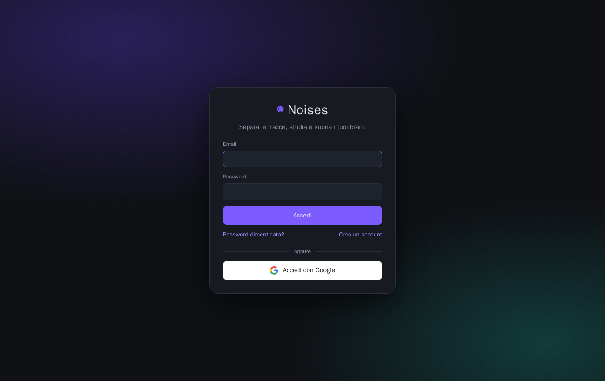
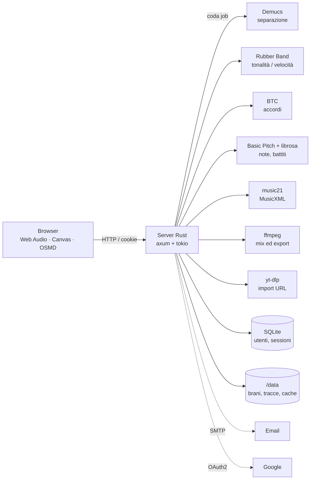

<div align="center">

# ◉ Noises

**Separa le tracce, studia e suona i tuoi brani.**

Web app self-hosted in stile Moises: separazione delle tracce con l'AI, mixer multitraccia,
cambio di tonalità e velocità indipendenti, accordi, trascrizione delle note, spartito, tablatura,
click intelligente ed esportazione di basi.




</div>

---

## Indice

- [Funzionalità](#funzionalità)
- [Avvio rapido](#avvio-rapido)
- [Guida all'uso](#guida-alluso)
- [Autenticazione](#autenticazione)
- [Configurazione](#configurazione)
- [Architettura](#architettura)
- [API](#api)
- [Comandi make](#comandi-make)
- [Limiti noti](#limiti-noti)
- [Crediti e licenze di terze parti](#crediti-e-licenze-di-terze-parti)

## Funzionalità

### Separazione e mixer
- **Separazione delle tracce** con [Demucs v4](https://github.com/facebookresearch/demucs): 4 tracce (voce, batteria, basso, altro), 4 tracce in alta qualità, oppure 6 tracce (+ chitarra e piano).
- **Elaborazione su richiesta**: i brani caricati restano "da elaborare"; sei tu a scegliere quando avviare separazione e analisi.
- **Import da URL** (YouTube e gli altri siti supportati da yt-dlp).
- **Mixer** con muto, solo e volume per traccia, volume master e download delle singole tracce.
- **Tonalità** (±12 semitoni) e **velocità** (50–150%) indipendenti, con [Rubber Band](https://breakfastquay.com/rubberband/); le versioni elaborate restano in cache.

### Timeline
- **Zoom** in pixel al secondo (slider, `Ctrl` + rotella o pinch), **panoramica** del brano con un riquadro da trascinare.
- **Selezione** col trascinamento, **loop** sincronizzato con precisione al campione, riproduzione della sola selezione.
- **Impostazioni salvate per brano** (tonalità, velocità, volumi, muto/solo, selezione, loop) con pulsanti Salva e Reset.

### Analisi musicale
- **Accordi** con [BTC](https://github.com/jayg996/BTC-ISMIR19): 170 accordi (maj, min, 7, maj7, m7, 6, m6, sus2, sus4, dim, dim7, m7♭5, aug, m(maj7)). Corsia degli accordi, accordo corrente e successivo, notazione C D E / Do Re Mi, **correzione manuale** (cambiare, dividere, unire, spostare i cambi).
- **Trascrizione delle note** di tutte le tracce con [Basic Pitch](https://github.com/spotify/basic-pitch) e un rilevatore dei colpi di batteria per bande di frequenza (cassa, rullante, hi-hat).
- **Piano roll modificabile** per ogni traccia: spostare, allungare, aggiungere ed eliminare note, agganciate alla griglia ritmica.
- **Synth** per ascoltare le note trascritte insieme all'audio originale.

### Spartito, ritmo e basi
- **Spartito** (MusicXML generato con music21, visualizzato con OpenSheetMusicDisplay): pianoforte su doppio pentagramma, batteria in notazione percussiva, alterazioni secondo la tonalità. Stampa, PDF ed export MusicXML.
- **Tablatura** per chitarra (anche Drop D) e basso a 4 o 5 corde, con corde e tasti scelti per limitare gli spostamenti della mano e gli accordi sopra le battute.
- **Cursore** che segue la riproduzione nello spartito e nella tablatura.
- **Click intelligente** che segue i battiti rilevati nel brano, anche quando il tempo varia, con l'accento sul primo tempo.
- **Metro** selezionabile (2/4, 3/4, 4/4, 5/4, 6/8, 12/8), spostamento del primo tempo, correzione del battito ×2/÷2.
- **Pre-conteggio** di 1 o 2 battute, che porta esattamente sul battito successivo.
- **Esportazione** in MP3, WAV, FLAC o MIDI delle sole tracce attive (per esempio la base senza voce), del brano intero o della selezione, con **click e pre-conteggio** inclusi per creare basi.

### Account
- **Registrazione con verifica dell'email**, accesso, password dimenticata con reset via email, cambio password.
- **Accesso con Google** (OAuth 2.0 / OpenID Connect con PKCE).
- **Più utenti**: ognuno vede solo i propri brani e le proprie playlist.
- **Playlist** (un brano può stare in più playlist) e ricerca nella libreria.

## Avvio rapido

Requisiti: Docker con Compose v2 e `make`. Servono circa 6 GB di disco per l'immagine, che contiene PyTorch e i modelli, così l'app funziona anche senza internet.

```sh
git clone https://github.com/teopost/noises.git
cd noises
cp .env.example .env      # facoltativo: SMTP, Google SSO, porta…
make up                   # build + avvio
make open                 # apre http://localhost:8080
```

Al primo accesso **registra un account**: il primo utente diventa amministratore. Se l'SMTP non è configurato, il link di conferma lo trovi nei log:

```sh
make logs   # cerca la riga "[email non inviata — SMTP assente] … → http://…/api/auth/verify?token=…"
```

> In alternativa, imposta `EMAIL_VERIFICATION=false` in `.env` per attivare gli account senza conferma.

## Guida all'uso

1. **Carica** uno o più file audio (trascinali nella barra laterale) oppure incolla un link YouTube.
2. Premi **▶ Elabora** sul brano, scegli il tipo di separazione e le analisi da eseguire (accordi; ritmo e note).
3. Quando il brano è **Pronto**, aprilo: hai la timeline con le tracce, gli accordi e i comandi.

| Azione | Come |
|---|---|
| Play / pausa | `Spazio` o ▶ |
| Avanti / indietro 5 s | `→` / `←` |
| Selezionare una porzione | trascina sulla timeline o sul righello |
| Loop della selezione | `L` o ⟳ Loop |
| Annullare selezione / chiudere i menu | `Esc` |
| Zoom | `Ctrl` + rotella, pinch, slider, oppure i bordi del riquadro nella panoramica |
| Scorrere | trascina il riquadro della panoramica, `Shift` + rotella, trackpad |
| Note di una traccia | pulsante ♪ sulla traccia → piano roll |
| Modificare le note | clic per selezionare · trascina per spostare · bordo destro per la durata · doppio clic per aggiungere · `Canc` per eliminare · `↑`/`↓` per un semitono · `Shift` per muoversi senza griglia |
| Correggere un accordo | clic sull'accordo; trascina il bordo sinistro per spostare il cambio |
| Spartito / tablatura | 𝄞 Spartito nella corsia delle note |
| Metro e click | sezione **Ritmo**: `4/4 ▾`, 🥁 Click, pre-conteggio |

Per creare una **base**: metti in muto la voce, poi **⤓ Esporta** con *Click per tutto il brano* e *Pre-conteggio 1 battuta*.

## Autenticazione

| Funzione | Dettagli |
|---|---|
| Password | Argon2id (m=19 MiB, t=2), almeno 8 caratteri con lettere e un numero o simbolo |
| Sessioni | token casuale da 256 bit in un cookie `HttpOnly`, `SameSite=Lax` (`Secure` se `PUBLIC_URL` è https); nel database c'è solo l'hash SHA-256; durata 30 giorni |
| Verifica email | link monouso valido 48 ore; finché non è confermata, l'accesso viene rifiutato e si può richiedere un nuovo link |
| Password dimenticata | link monouso valido 1 ora; il reset chiude tutte le altre sessioni |
| Protezione | blocco di 15 minuti dopo 8 tentativi falliti; messaggi che non rivelano se un'email è registrata |
| Google | Authorization Code + PKCE (S256), parametro `state` contro il CSRF; l'account viene collegato tramite l'email verificata da Google |

### Configurare l'accesso con Google

1. Su [Google Cloud Console](https://console.cloud.google.com/apis/credentials) crea un **ID client OAuth** di tipo *Applicazione web*.
2. Aggiungi l'**URI di reindirizzamento autorizzato**: `${PUBLIC_URL}/api/auth/google/callback` (es. `http://localhost:8080/api/auth/google/callback`).
3. Inserisci in `.env` i valori `GOOGLE_CLIENT_ID` e `GOOGLE_CLIENT_SECRET`, poi esegui `make up`. Nella schermata di accesso compare il pulsante **Accedi con Google**.

### Configurare l'invio delle email (SMTP)

Imposta `SMTP_HOST`, `SMTP_PORT`, `SMTP_USER`, `SMTP_PASSWORD`, `SMTP_FROM` e `SMTP_TLS` (`starttls` sulla 587, `tls` sulla 465, `none` solo per server locali di test). Le email sono in formato testo + HTML.

### Dati esistenti

I brani creati prima dell'introduzione degli account vengono assegnati automaticamente al **primo utente** che si registra.

## Configurazione

Tutte le variabili si possono impostare in `.env` (vedi [`.env.example`](.env.example)).

| Variabile | Default | Descrizione |
|---|---|---|
| `NOISES_PORT` | `8080` | porta esposta |
| `PUBLIC_URL` | `http://localhost:8080` | URL pubblico, usato nei link delle email e nel redirect di Google |
| `EMAIL_VERIFICATION` | `true` | richiede la conferma dell'email alla registrazione |
| `ALLOW_REGISTRATION` | `true` | consente nuove registrazioni |
| `GOOGLE_CLIENT_ID` / `GOOGLE_CLIENT_SECRET` | — | attivano l'accesso con Google |
| `SMTP_*` | — | invio delle email (senza SMTP i link vanno nei log) |
| `DEMUCS_DEVICE` | `cpu` | `cuda` richiede un'immagine PyTorch con GPU |
| `DEMUCS_THREADS` | `4` | thread PyTorch per la separazione (sulle CPU ibride 4 è spesso il valore più veloce) |
| `RUBBERBAND_ARGS` | *(vuoto)* | vuoto = motore R2, veloce; `-3` = motore R3, qualità migliore ma ~6× più lento |
| `RENDER_JOBS` | `0` | elaborazioni di tonalità e velocità in parallelo (0 = numero di CPU) |
| `RUST_LOG` | `info` | livello di log |

## Architettura



| Livello | Tecnologia | Percorso |
|---|---|---|
| Server HTTP, coda, autenticazione, streaming | Rust · axum · tokio · rusqlite · argon2 · lettre · reqwest | `backend/` |
| Separazione | Demucs v4 (PyTorch, CPU) | — |
| Tonalità e velocità | Rubber Band (C++) | — |
| Accordi | BTC, vocabolario da 170 classi | `analysis/chords.py` |
| Note e battiti | Basic Pitch (ONNX, senza TensorFlow), librosa | `analysis/transcribe.py` |
| Spartito | music21 → MusicXML | `analysis/score.py` |
| Frontend | HTML/CSS/JS senza framework, Web Audio API, OpenSheetMusicDisplay | `frontend/` |

Il lavoro pesante lo fanno librerie native (PyTorch, Rubber Band, ffmpeg) che il server Rust orchestra. Il browser decodifica le tracce una volta sola, poi mixa, fa il loop e suona il synth localmente con la Web Audio API, così la riproduzione resta sincronizzata.

### Dati

Tutto sta nel volume Docker `noises-data` (`/data`):

```
/data
├── noises.db                 # utenti, sessioni, token (SQLite)
├── playlists.json
└── songs/<id>/
    ├── meta.json             # stato, proprietario, impostazioni, metro
    ├── input.<ext>           # file originale
    ├── stems/*.flac          # tracce separate
    ├── render/*.flac         # cache di tonalità e velocità
    ├── chords.json           # accordi rilevati  (+ chords.edited.json)
    └── notes.json            # note e griglia    (+ notes.edited/<traccia>.json)
```

## API

Tutte le API sotto `/api` (tranne `/api/auth/*` e `/api/health`) richiedono una sessione valida e operano solo sulle risorse dell'utente.

<details>
<summary>Elenco degli endpoint</summary>

| Metodo | Percorso | Descrizione |
|---|---|---|
| `GET` | `/api/auth/config` | funzioni di accesso disponibili |
| `POST` | `/api/auth/register` · `/login` · `/logout` | registrazione, accesso, uscita |
| `GET` | `/api/auth/verify?token=` | conferma dell'email |
| `POST` | `/api/auth/resend` · `/forgot` · `/reset` | nuovo link di verifica, password dimenticata, reset |
| `GET` | `/api/auth/me` | utente corrente |
| `GET` | `/api/auth/google/login` · `/callback` | accesso con Google |
| `POST` | `/api/account/password` | cambio password |
| `GET` `POST` | `/api/songs` | elenco, caricamento (multipart) |
| `POST` | `/api/import` | import da URL |
| `GET` `DELETE` | `/api/songs/:id` | dettagli, eliminazione |
| `POST` | `/api/songs/:id/process` | avvio di separazione e analisi |
| `GET` | `/api/songs/:id/stems/:stem?pitch=&tempo=` | traccia (FLAC), con tonalità e velocità applicate |
| `POST` | `/api/songs/:id/export` | mix delle tracce attive, con click e pre-conteggio opzionali |
| `PUT` `DELETE` | `/api/songs/:id/settings` | impostazioni del mixer |
| `GET` `PUT` | `/api/songs/:id/chords` | accordi (`POST …/analyze`, `DELETE …/edits`) |
| `GET` | `/api/songs/:id/notes` | note e griglia (`POST …/analyze`, `PUT …/:stem`, `DELETE …/:stem/edits`) |
| `PUT` | `/api/songs/:id/rhythm` | metro, primo tempo, correzione del battito |
| `POST` | `/api/songs/:id/score/:stem` | MusicXML ed eventi per la tablatura |
| `GET` `POST` | `/api/playlists` | playlist (`PATCH`/`DELETE /:id`, `PUT`/`DELETE /:id/songs/:song`) |

</details>

## Comandi make

| Comando | Descrizione |
|---|---|
| `make up` | build e avvio in background |
| `make down` / `make stop` / `make restart` | ferma e rimuove, ferma, riavvia |
| `make logs` | segue i log |
| `make ps` | stato dei container |
| `make shell` | shell nel container |
| `make build` / `make rebuild` | build (senza cache con `rebuild`) |
| `make update-ytdlp` | aggiorna yt-dlp, utile quando YouTube cambia |
| `make open` | apre l'app nel browser |
| `make clean` | rimuove container, immagine e **volume dati** (cancella brani e account) |
| `make purge` | `clean` più pulizia della cache di build |

## Limiti noti

- La separazione su CPU è lenta: su un portatile richiede circa 3 s per ogni secondo di audio. Con una GPU NVIDIA è molto più veloce, ma serve un'immagine diversa.
- La trascrizione automatica è una base da correggere: va bene per batteria, basso e melodie semplici, peggio con chitarre distorte e parti polifoniche dense. La batteria distingue solo cassa, rullante e hi-hat.
- Il metro non viene rilevato automaticamente: si sceglie nel menu Ritmo.
- Accordi non presenti nel vocabolario (none, undicesime, rivolti) vengono ricondotti all'accordo base più vicino.
- Il browser tiene in memoria le tracce decodificate: circa 85 MB per traccia ogni 4 minuti di audio.
- Scarica e usa solo contenuti per cui hai i diritti, rispettando i termini dei servizi da cui li importi.

## Crediti e licenze di terze parti

| Componente | Licenza |
|---|---|
| [Demucs](https://github.com/facebookresearch/demucs) | MIT |
| [BTC-ISMIR19](https://github.com/jayg996/BTC-ISMIR19) | MIT |
| [Basic Pitch](https://github.com/spotify/basic-pitch) | Apache-2.0 |
| [Rubber Band](https://breakfastquay.com/rubberband/) | GPL-2.0 (usato come programma esterno) |
| [music21](https://github.com/cuthbertLab/music21) | BSD-3-Clause |
| [OpenSheetMusicDisplay](https://github.com/opensheetmusicdisplay/opensheetmusicdisplay) | BSD-3-Clause |
| [librosa](https://github.com/librosa/librosa) | ISC |
| [yt-dlp](https://github.com/yt-dlp/yt-dlp) | Unlicense |
| [FFmpeg](https://ffmpeg.org/) | LGPL/GPL |
